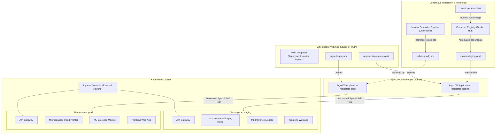

# Cloud-Native GitOps Delivery Platform (Helm & Argo CD)


Unified Helm chart and declarative GitOps continuous delivery engine orchestrating the microservices, machine learning inference engines, and API gateway services across **Staging** and **Production** Kubernetes environments.

---

## 🏛️ GitOps Architecture & Deployment Lifecycle

The platform operates on pure **declarative GitOps**. Git is the single source of truth for the entire cluster state. Changes are committed to Git, and Argo CD continuously reconciles the live Kubernetes cluster to match the repository state.



---

## 🔄 Multi-Environment Management: Staging vs. Production

Instead of maintaining disjointed manifests or separate charts for every microservice, this repository leverages the **Unified Meta-Chart Pattern**:
- Reusable, generic templates (`templates/deployment.yaml`, `templates/service.yaml`, `templates/ingress.yaml`) iterate dynamically over the services defined in values.
- Environmental divergence is managed cleanly through distinct value files: [values-staging.yaml](file:///home/junaid_uth/projects/RealEstateRental/realestate-chart/values-staging.yaml) and [values-prod.yaml](file:///home/junaid_uth/projects/RealEstateRental/realestate-chart/values-prod.yaml).

### Environment Comparison

| Dimension | Staging (`values-staging.yaml`) | Production (`values-prod.yaml`) |
| :--- | :--- | :--- |
| **Target Namespace** | `staging` | `prod` |
| **Argo CD App** | `realestate-staging` | `realestate-prod` |
| **Spring Active Profile** | `staging` | `prod` |
| **Replica Strategy** | Scaled to zero / on-demand for cloud cost saving | High availability (`replicaCount >= 1`) |
| **Image Tag Policy** | Rapid iterations (`latest` or specific commit hash) | Immutable promoted semantic releases |
| **Secret Sourcing** | Encrypted staging secrets | Production-grade sealed credentials |
| **Ingress IngressClass** | Environment-scoped routing rules | Production TLS & default IngressClass |

---

## ⚡ Automated GitOps Deployments with Argo CD

Two dedicated Argo CD Custom Resources (`Application`) define declarative synchronization policies across both environments:

### 1. Staging Application (`argocd-staging-app.yaml`)
Monitors the repository for changes and renders the chart using `values-staging.yaml` into the `staging` namespace:
```yaml
apiVersion: argoproj.io/v1alpha1
kind: Application
metadata:
  name: realestate-staging
  namespace: argocd
spec:
  project: default
  source:
    repoURL: 'https://github.com/RealEstate-Rental-JunaidUth-version/K8s-Chart.git'
    targetRevision: main
    path: '.'
    helm:
      valueFiles:
        - values-staging.yaml
  destination:
    server: 'https://kubernetes.default.svc'
    namespace: staging
  syncPolicy:
    automated:
      prune: true      # Automatically deletes resources removed from Git
      selfHeal: true   # Reverts manual ad-hoc cluster drift back to Git state
    syncOptions:
      - CreateNamespace=true
      - Replace=true
      - ServerSideApply=true
```

### 2. Production Application (`argocd-app.yaml`)
Enforces production reliability using `values-prod.yaml` targeting the `prod` namespace:
```yaml
apiVersion: argoproj.io/v1alpha1
kind: Application
metadata:
  name: realestate-prod
  namespace: argocd
spec:
  project: default
  source:
    repoURL: 'https://github.com/RealEstate-Rental-JunaidUth-version/K8s-Chart.git'
    targetRevision: main
    path: '.'
    helm:
      valueFiles:
        - values-prod.yaml
  destination:
    server: 'https://kubernetes.default.svc'
    namespace: prod
  syncPolicy:
    automated:
      prune: true
      selfHeal: true
    syncOptions:
      - CreateNamespace=true
      - Replace=true
      - ServerSideApply=true
```

### Key GitOps Operational Benefits:
- **Zero In-Cluster Deployer Credentials**: CI systems (Jenkins/GitHub Actions) never require direct `kubectl` access to the production cluster. They only write commits to Git.
- **Drift Detection & Self-Healing**: If an operator manually modifies or deletes a deployment in Kubernetes, Argo CD detects the divergence and immediately restores the state defined in Git.
- **Automated Pruning**: When a service or config is deleted from `values.yaml`, Argo CD cleanly deletes the matching Kubernetes objects.

---

## 🚀 Environment Promotion Pipeline (`Jenkinsfile`)

Release promotion from **Staging** to **Production** is handled via an automated, auditable pipeline:

1. **Selection**: The operator or pipeline specifies which microservice to promote (e.g. `gateway-service`, `property-microservice`).
2. **Extraction**: The pipeline clones the GitOps repo and reads the verified image tag currently running in `values-staging.yaml` using `yq`.
3. **Immutability Enforcement**: Verifies the staging tag is a valid, immutable version (blocking untagged or `latest` promotions).
4. **Git Mutation**: Updates the target tag in `values-prod.yaml`.
5. **GitOps Trigger**: Commits and pushes the change back to the repository (`chore(prod): promote <service> to <tag> [skip ci]`).
6. **Continuous Delivery**: Argo CD automatically detects the Git push and performs a zero-downtime rolling update in the `prod` namespace.

---

## 🧩 Microservices & AI Architecture Managed by Helm

The Helm chart dynamically iterates over all platform components:

### 1. Edge & Core Infrastructure
- **`gateway-service`**: Spring Cloud Gateway routing incoming external traffic to appropriate backend services.
- **`config-service`**: Centralized Spring Cloud Configuration server providing dynamic configuration to microservices on startup.
- **`public-app`**: Frontend web user interface.

### 2. Domain Microservices
- **`auth-server`**: OAuth2/JWT authentication and token issuance.
- **`user-management-service`**: User profiles, tenant identities, and access control.
- **`property-microservice`**: Property cataloging, metadata, and asset lifecycle.
- **`rental-agreement-microservice`**: Digital rental contracts, agreements, and execution state.
- **`notification-service`**: Event alerts, messaging, and email/SMS triggers.

### 3. Machine Learning & Predictive AI Engines
- **`ml-pricesuggestionmodel`**: AI real estate valuation and dynamic price suggestion engine.
- **`predictive-heatmaps-of-neighborhood-price-evolution`**: Geospatial heatmap and price trend forecaster.
- **`property-recommendation-engine`**: K-Means & Cosine-Similarity personalized recommendation engine.
- **`tenant-risk-scoring`**: Random Forest tenant risk assessment and classification model.

---

## 🔒 Secret Management Architecture

- **Bitnami Sealed Secrets**: Asymmetric public/private key cryptography.
- **Developer Workflow**: Developers use the `kubeseal` CLI with the cluster's public certificate to seal plaintext Kubernetes secrets into `SealedSecret` custom resources.
- **Safe Git Storage**: Encrypted `SealedSecret` files can be safely checked into Git.
- **In-Cluster Decryption**: The in-cluster Sealed Secrets controller uses its pre-injected private key to decrypt `SealedSecret` manifests into native Kubernetes `Secret` objects accessible by application pods.

---

## 📂 Repository Directory Layout

```
realestate-chart/
├── Chart.yaml                  # Chart metadata and subchart dependencies
├── values-staging.yaml         # Configuration parameters for Staging environment
├── values-prod.yaml            # Configuration parameters for Production environment
├── argocd-staging-app.yaml     # Argo CD Application manifest for Staging (namespace: staging)
├── argocd-app.yaml             # Argo CD Application manifest for Production (namespace: prod)
├── Jenkinsfile                 # Automated Staging-to-Production tag promotion pipeline
├── sealed-secrets/             # Encrypted SealedSecret manifests safe for Git
├── templates/
│   ├── deployment.yaml         # Parameterized Deployment template iterating over microservices
│   ├── service.yaml            # Parameterized Service template generating ClusterIP services
│   └── ingress.yaml            # Ingress rules for external traffic routing
└── README.md                   # Architecture and GitOps deployment documentation
```

---

## 🛠️ Verification & Local Linting

Validate and render templates locally before pushing changes:

```bash
# 1. Lint the Helm chart syntax
helm lint .

# 2. Dry-run template generation for Staging
helm template realestate-staging . -f values-staging.yaml --namespace staging

# 3. Dry-run template generation for Production
helm template realestate-prod . -f values-prod.yaml --namespace prod
```
